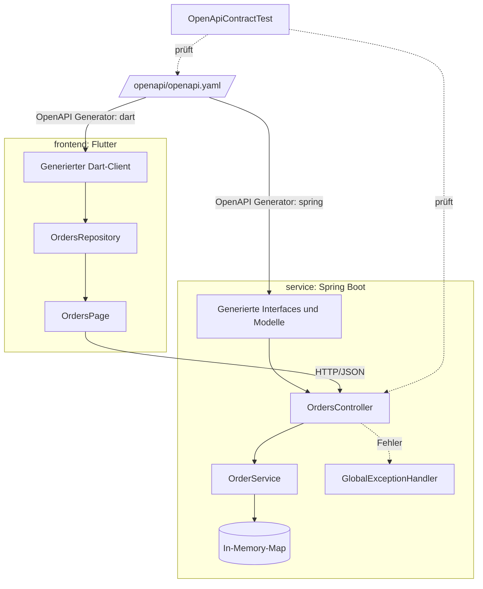
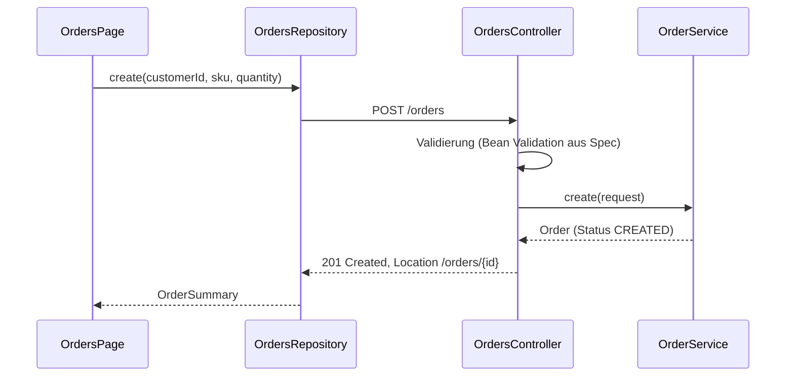
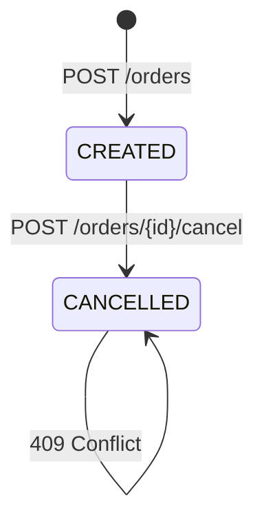

# Architektur

Ein Vertrag, zwei Konsumenten: Der Service implementiert die generierten Server-Interfaces,
das Frontend nutzt einen generierten Client.

## Bausteine

## Ablauf: Bestellung anlegen

## Lebenszyklus einer Bestellung

Das Stornieren ist atomar (`ConcurrentHashMap.computeIfPresent`). Unbekannte IDs liefern 404,
eine bereits stornierte Bestellung liefert 409; beide Fehler als RFC-9457-Problem-Details.

## Entscheidungen

- [ADR 0001: Spec-first mit OpenAPI](adr/0001-spec-first-openapi.md)
