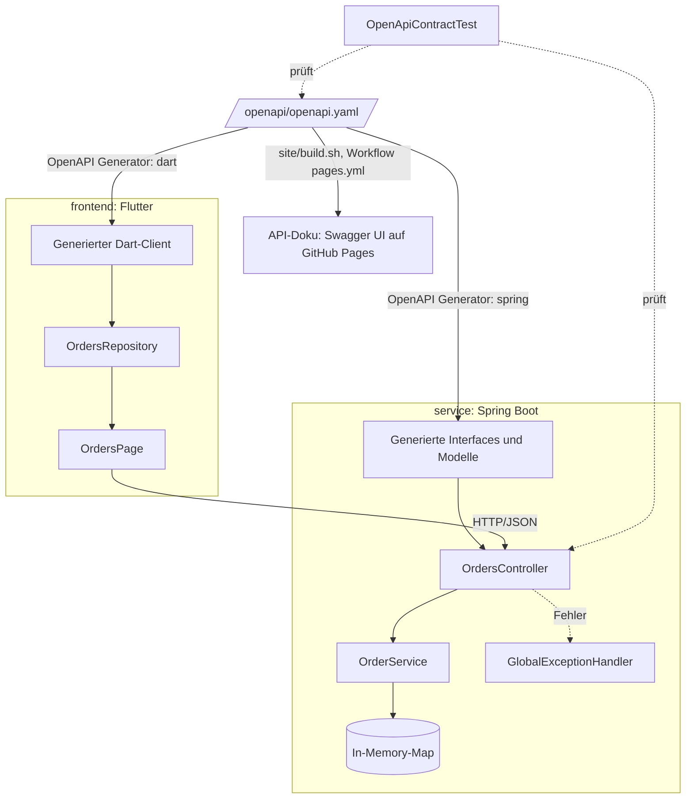
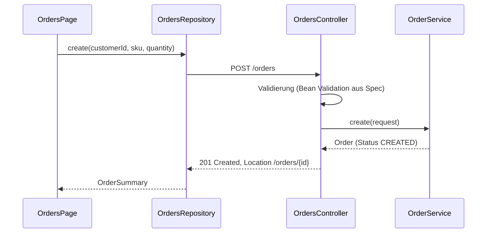
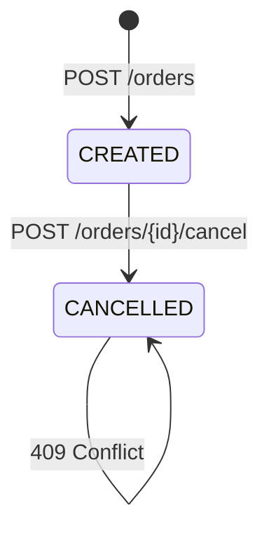
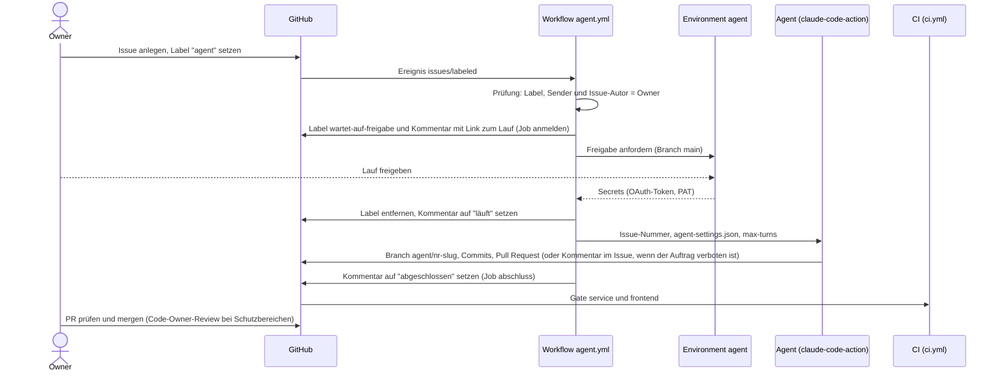
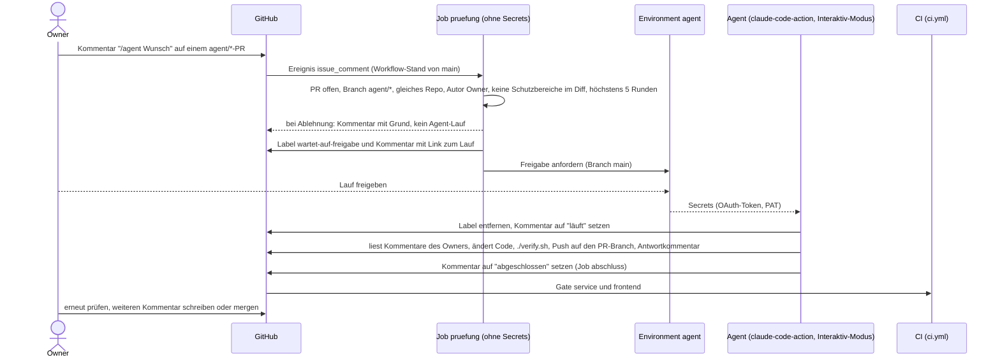

# Architektur

Ein Vertrag, zwei Konsumenten: Der Service implementiert die generierten Server-Interfaces,
das Frontend nutzt einen generierten Client.

## Bausteine

Die API-Doku wird nicht von Hand gepflegt: Bei jeder Änderung an `openapi/` auf `main` baut `site/build.sh` die Seite
(Spec prüfen, Swagger UI per Commit-SHA holen, Seite erzeugen), der Workflow `pages.yml` veröffentlicht sie auf GitHub
Pages. Die Seite ist nur lesend („Try it out“ ist abgeschaltet, es gibt keinen erreichbaren Service) und verlinkt
Architektur, Prozess, Betrieb und ADRs.

## Ablauf: Bestellung anlegen

## Lebenszyklus einer Bestellung

Das Stornieren ist atomar (`ConcurrentHashMap.computeIfPresent`). Unbekannte IDs liefern 404,
eine bereits stornierte Bestellung liefert 409; beide Fehler als RFC-9457-Problem-Details.

## Ablauf: automatischer Agent-Lauf (Stufe 2)

Pro Issue läuft höchstens ein Lauf (`concurrency`), verschiedene Issues dürfen parallel laufen.
Der Agent liest den Issue-Text selbst und behandelt ihn als Daten. Schutzbereiche (Workflows, Gate, Build-Skripte)
darf er nicht ändern; die Grenze setzen `CODEOWNERS` und das Ruleset. Details: ADR 0002.

## Ablauf: Review-Schleife per Kommentar

`issue_comment` läuft immer mit der Workflow-Datei von `main`; ein PR kann den Workflow also nicht verändern. Der Job
`pruefung` entscheidet vor der Freigabe, ob der Befehl zulässig ist. Pro PR läuft höchstens ein Lauf. Die Schleife ist
ein Spike und noch nicht im Echtbetrieb bewertet (Roadmap P2).

## Gestaltung von Mermaid-Diagrammen

Diagramme ohne eigenes Styling übernehmen das Theme von GitHub und sind im hellen wie im dunklen Modus lesbar. Wer
Knoten einfärbt (zum Beispiel Status im Überblick von [roadmap.md](roadmap.md)), setzt in jedem `classDef` neben `fill`
und `stroke` auch eine feste Schriftfarbe `color`, denn GitHub färbt den Text im Darkmode hell, die Füllung bliebe aber
hell. Verwendet werden helle Füllungen mit `color:#1f2328`: erledigt `fill:#d4edda,stroke:#2d6a3e`, in Arbeit
`fill:#fff3cd,stroke:#8a6d1c`, geplant `fill:#eef0f3,stroke:#6b7280`. Der Kontrast von Text zu Füllung muss mindestens
4,5 : 1 (WCAG AA) betragen; mit diesen Farben liegt er bei etwa 12 : 1 bis 14 : 1.

## Entscheidungen

- [ADR 0001: Spec-first mit OpenAPI](adr/0001-spec-first-openapi.md)
- [ADR 0002: Absicherung automatischer Agent-Läufe](adr/0002-agent-sicherheit.md)
