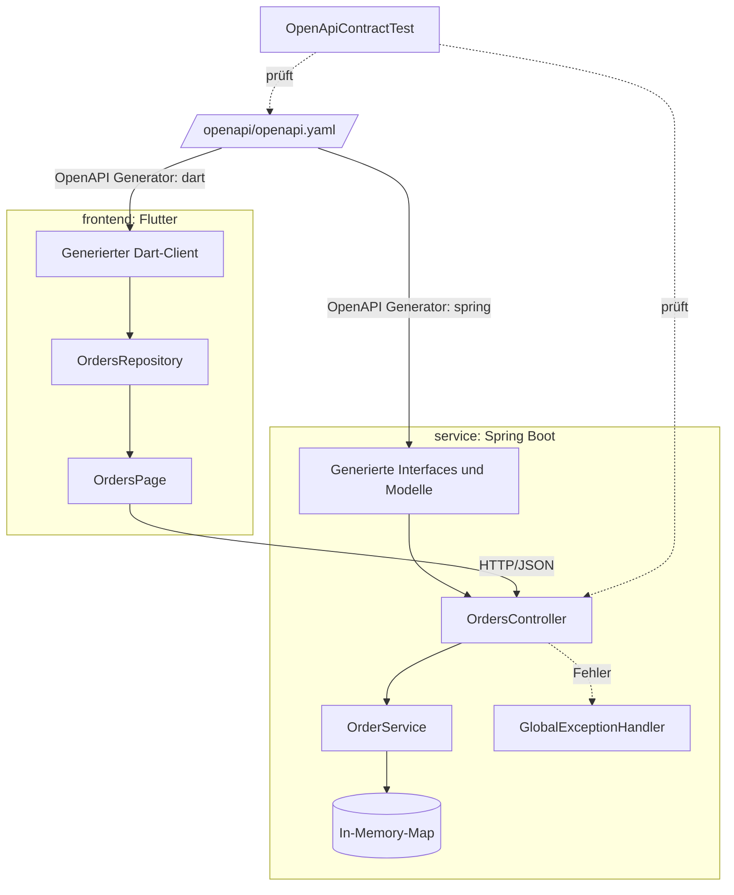
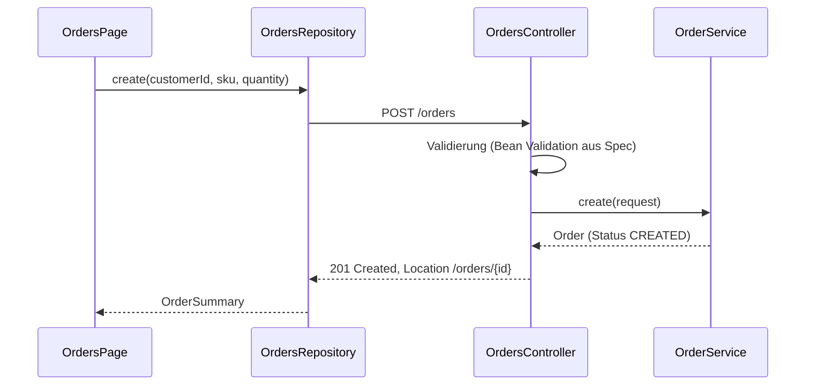
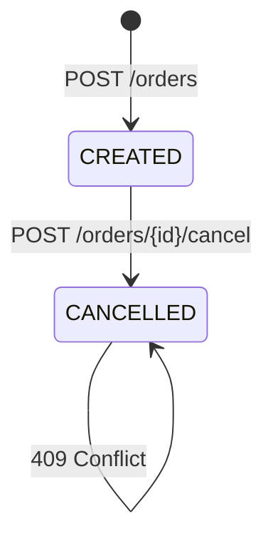
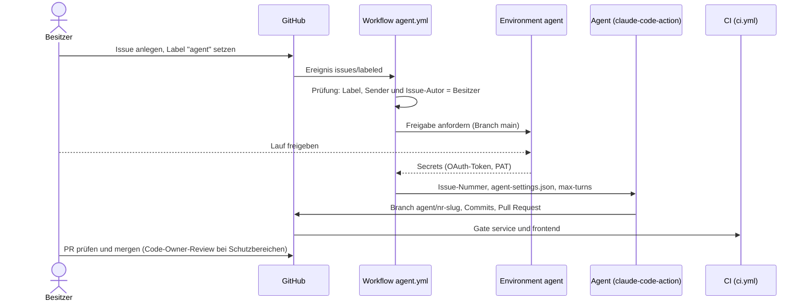

# Architektur

Ein Vertrag, zwei Konsumenten: Der Service implementiert die generierten Server-Interfaces,
das Frontend nutzt einen generierten Client.

## Bausteine

## Ablauf: Bestellung anlegen

## Lebenszyklus einer Bestellung

Das Stornieren ist atomar (`ConcurrentHashMap.computeIfPresent`). Unbekannte IDs liefern 404,
eine bereits stornierte Bestellung liefert 409; beide Fehler als RFC-9457-Problem-Details.

## Ablauf: automatischer Agent-Lauf (Stufe 2)

Der Agent liest den Issue-Text selbst und behandelt ihn als Daten. Schutzbereiche (Workflows, Gate, Build-Skripte)
darf er nicht ändern; die Grenze setzen `CODEOWNERS` und das Ruleset. Details: ADR 0002.

## Entscheidungen

- [ADR 0001: Spec-first mit OpenAPI](adr/0001-spec-first-openapi.md)
- [ADR 0002: Absicherung automatischer Agent-Läufe](adr/0002-agent-sicherheit.md)
