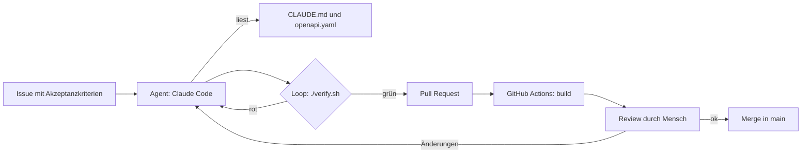

# Software-Factory-Prozess

## Ablauf (Stufe 1: manuell angestoßen)

Der **Loop** ist der Kern: Der Agent ändert Code, führt `./verify.sh` aus, liest die Fehler und korrigiert,
bis das Gate grün ist. Ohne dieses Feedback gibt es kein belastbares „geprüft“.

## Beobachtbarkeit

| Was | Wo |
|---|---|
| Auftrag und Diskussion | GitHub Issue |
| Ergebnis | Pull Request mit Diff und Beschreibung |
| Prüfung | GitHub Actions (Jobs `service` und `frontend`), Berichte als Artefakt |
| Architektur und Entscheidungen | `docs/architecture.md`, `docs/adr/` |

## Ausbaustufen

1. **Template-Repo** (dieses Repo): Agent arbeitet an einem Issue, du prüfst den PR.
2. **Automatisierung:** Label `agent` am Issue startet den Agent per GitHub Action (Claude-Code-Action oder Headless-Lauf).
3. **Rollen:** Planer, Implementierer und Reviewer als Subagents/Skills in `.claude/`.
4. **Orchestrator:** Eigener Graph mit dem Claude Agent SDK (Knoten = Rollen, Kanten = Übergaben, Schleife = Review → Fix).
5. **Wiederverwendung:** Skills und Templates in einem eigenen Factory-Repo für weitere Stacks.
