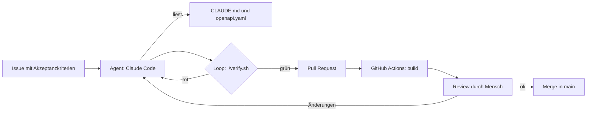
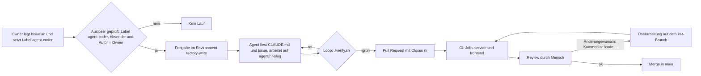

# Software-Factory-Prozess

## Ablauf (Stufe 1: manuell angestoßen)

Der **Loop** ist der Kern: Der Agent ändert Code, führt `./verify.sh` aus, liest die Fehler und korrigiert,
bis das Gate grün ist. Ohne dieses Feedback gibt es kein belastbares „geprüft“.

## Ablauf (Stufe 2: Label startet den Lauf)

Gegenüber Stufe 1 startet der Lauf automatisch, sobald der Owner das Label `agent-coder` setzt, und nur dann, wenn
Absender und Issue-Autor der Owner sind. Jeder Lauf wartet auf eine Freigabe im GitHub-Environment `factory-write`.
Schutzbereiche (Workflows, Gate, Build-Skripte) darf der Agent nicht ändern, dafür sorgen Code-Owner-Review und
Ruleset. Die Begründungen stehen in [ADR 0002](adr/0002-agent-sicherheit.md).

**Review-Schleife (Spike, Roadmap P2):** Bei Änderungswünschen schreibt der Owner auf dem `agent/*`-PR einen
Kommentar, der mit `/code` beginnt (übergangsweise gilt auch der frühere Befehl `/agent`). Der Workflow
`agent-coder-revise.yml` („💻 agent-coder: /code Revise“) prüft zuerst ohne Secrets (offener PR, Branch
`agent/*`, keine Schutzbereiche im Diff, höchstens 5 Runden) und fragt dann die Freigabe im Environment an. Der Agent
arbeitet auf demselben Branch, führt `./verify.sh` aus und antwortet mit einem Kommentar. Ändert der PR Schutzbereiche,
lehnt die Prüfung ab und nennt den Grund; dann arbeitet der Owner selbst weiter. Geht der Wunsch über den PR hinaus,
wird das Issue angepasst und das Label neu gesetzt.

**Rückfrage statt Raten (Roadmap P5):** Ist ein Akzeptanzkriterium deutlich mehrdeutig, baut der Agent nichts auf
Verdacht. Er stellt seine Fragen als Kommentar ins Issue und beendet den Lauf. Der Owner antwortet im Issue und
setzt das Label `agent-coder` erneut (Label entfernen, wieder setzen).

**Freigabe und Lauf sichtbar machen (Roadmap B7):** Jeder Lauf braucht eine Freigabe im Environment `factory-write`. Damit du
nicht unter Actions suchen musst, zeigt die Factory den Zustand dort, wo du arbeitest:
- **Label `wartet-auf-freigabe`** am Issue bzw. PR, solange der Lauf wartet. In der Liste filterst du mit
  `label:wartet-auf-freigabe`.
- **Ein Kommentar pro Lauf mit Link** auf die Lauf-Seite, auf der du freigibst. Er wird aktualisiert: ⏳ wartet →
  ▶️ läuft → ✅ abgeschlossen, ❌ ohne Erfolg (Fehler oder abgelehnt) oder ⛔ abgebrochen. Den Kommentar legt beim Issue
  der Job `anmelden` an, beim PR der Job `pruefung`; der Job `abschluss` schließt ihn ab und entfernt das Label, auch
  nach einer Ablehnung. Alle drei Jobs laufen ohne Environment und ohne Secrets.

**Meilenstein:** Der Job `abschluss` übernimmt nach einem erfolgreichen Lauf den Meilenstein des Issues auf den PR des
Agents (Branch `agent/<issue>-*`, nur wenn der PR noch keinen hat). Hat das Issue keinen, bleibt der PR ohne. Den
Meilenstein setzt du also einmal am Issue.

**Vertrag ansehen (Roadmap X3):** Berührt ein PR `openapi/**`, legt der Workflow `vertrag-vorschau.yml` einen Kommentar mit
twei Links an: **Vorher** (Seite von `main`) und **Nachher** (dieselbe Seite mit dem Vertrag des PR-Stands). Der Kommentar
wird bei jedem neuen Push aktualisiert. Ohne Änderung an `openapi/` gibt es ihn nicht.

Kommentare von `GITHUB_TOKEN` lösen keinen weiteren Workflow aus und zählen nicht als `/code`-Runde (gezählt werden
nur Kommentare des Owners). Schlägt das Kommentieren fehl, bleibt es bei einer Warnung und der Lauf läuft weiter.
Soll der Ablauf um einen weiteren Schritt oder Zustand wachsen, wird der Kommentar im selben Job aktualisiert und nicht
durch zusätzliche Kommentare ergänzt.
Liegt der Branch hinter `main`, holt der Agent `main` per Merge-Commit nach (kein Rebase, kein Force-Push, Roadmap P6).

## Wenn der Agent nicht liefern kann

Betrifft ein Auftrag nur Schutzbereiche oder verlangt er etwas Verbotenes, eröffnet der Agent keinen Pull Request.
Stattdessen schreibt er einen Kommentar ins Issue. Der Kommentar nennt, was verlangt wurde, welche Regel es
verhindert und was der Owner selbst tun muss. Die Regeln und ihre Begründung stehen in
[ADR 0002](adr/0002-agent-sicherheit.md).

## Beobachtbarkeit

| Was | Wo |
|---|---|
| Auftrag und Diskussion | GitHub Issue |
| Ergebnis | Pull Request mit Diff und Beschreibung |
| Prüfung | GitHub Actions (Jobs `service` und `frontend`), Berichte als Artefakt |
| Wartende Freigabe | Label `wartet-auf-freigabe` an Issue oder PR (Filter `label:wartet-auf-freigabe`) |
| Architektur und Entscheidungen | `docs/architecture.md`, `docs/adr/` |

## Ausbaustufen

1. **Template-Repo** (dieses Repo): Agent arbeitet an einem Issue, du prüfst den PR.
2. **Automatisierung (aktiv):** Label `agent-coder` am Issue startet den Agent per GitHub Action (`anthropics/claude-code-action`).
3. **Rollen:** Planer, Implementierer und Reviewer als Subagents/Skills in `.claude/`.
4. **Orchestrator:** Eigener Graph mit dem Claude Agent SDK (Knoten = Rollen, Kanten = Übergaben, Schleife = Review → Fix).
5. **Wiederverwendung:** Skills und Templates in einem eigenen Factory-Repo für weitere Stacks.

## Schreibweise

Damit bloße Nummern und ähnlich klingende Namen nicht verwechselt werden, gilt für Chat, Kommentare und den Fließtext
von Issues und PRs (nicht für Titel): **Emoji und Nummer, Issues, PRs und Bugs immer verlinkt.** Das Emoji nennt die
Art, deshalb steht das Wort „Issue“, „PR“ oder „Environment“ nicht dabei. Nie eine bloße Nummer (`#123`, `131`, `56`).

| Was | Schreibweise | Hinweis |
|---|---|---|
| Issue | `[📌 #123](https://github.com/juheba/sw-factory-tryout/issues/123)` | |
| Pull Request | `[🔀 #123](https://github.com/juheba/sw-factory-tryout/pull/123)` | Der Link zeigt auf `/pull/`, das unterscheidet ihn vom Issue. |
| Bug | `[🐛 #123](https://github.com/juheba/sw-factory-tryout/issues/123)` | Ein Bug ist ein Issue mit Label `bug`, der Link zeigt auf `/issues/`. |
| Environment | 🌐`factory-read` | Name in Backticks. |
| Coder | 💻`agent-coder` | |
| Reviewer | 🔎`agent-reviewer` | |
| QA | 🔬`agent-qa` | |
| Planer | 🧭`agent-planer` | |
| Owner | 👩🏽‍💻 Owner | der Mensch |
| Assistant | 💬 Assistant | arbeitet an der Factory selbst, nicht im Ablauf |

Regeln:

- **Immer Emoji, Nummer oder Name und, wo es einen gibt, den Link.** „🔀 #137“ mit Link, nie nur „#137“ oder „137“;
  „🌐`factory-read`“, nie nur „factory-read“; „🔎`agent-reviewer`“, wenn die Rolle gemeint ist.
- **Das Emoji ersetzt das Wort, nicht die Nummer.** Wer Emojis nicht darstellen kann, sieht im Link-Text nur die Nummer;
  deshalb steht die Art zusätzlich im Link-Ziel (`/issues/`, `/pull/`).
- **Sparsam bei allem anderen:** Zusätzliche Emojis nur in Überschriften und Zuständigkeitstabellen, nicht an jedem Wort.
- **Nicht in Titeln** von Issues und PRs: Dort stehen IDs wie `[P4]`, Emojis würden Suche und Filter erschweren.
- **Eine Bedeutung pro Emoji.** Die Zustandszeichen bleiben getrennt: ✅ erfüllt, ❌ verletzt oder Fehler,
  ⏳ wartet auf Freigabe, ▶️ läuft, ⛔ abgebrochen, ⚠️ in Arbeit, ⬜ offen, ❓ zu bewerten.
- **Probephase:** Die Kurzform gilt seit dem 31.10.2026 und wird im Betrieb bewertet. Fällt etwas auf (zum Beispiel
  Verwechslungen oder unleserliche Stellen), wird die Regel angepasst.

Beispiel: „[🔀 #137](https://github.com/juheba/sw-factory-tryout/pull/137) führt 🌐`factory-read` für
🔎`agent-reviewer` ein, die Umbenennung steht in
[📌 #138](https://github.com/juheba/sw-factory-tryout/issues/138).“

## Definition of Done

Die Datei [`config/definition-of-done.md`](../config/definition-of-done.md) ist der gemeinsame Maßstab für Coder,
Reviewer, QA und Owner. Sie liegt im Schutzbereich `config/`, damit der Coder die Latte nicht selbst absenkt; Reviewer
und QA lesen die Fassung aus `main`. Die Punkte sind nummeriert (`DoD-1` …) und nach Art der Prüfung markiert: **Gate**
(`./verify.sh` erzwingt es), **Sperre** (Berechtigungen, `.gitignore`, `CODEOWNERS` verhindern es) oder **Urteil**
(jemand muss lesen und beurteilen). Der Coder bewertet jeden Punkt im PR-Text, der Reviewer (Roadmap P4) bewertet die
Urteilspunkte und zitiert die Nummer. Wiederkehrende Befunde werden Teil der Liste (Roadmap P8).

## Reviewer

Der **Reviewer** (Roadmap P4, [Betrieb](betrieb.md#reviewer-einrichten-und-bedienen)) ist die zweite Rolle neben dem
Umsetzer. Er prüft einen PR oder ein Issue gegen die [Definition of Done](../config/definition-of-done.md), ohne
Freigabe und ohne Schreibrechte, und antwortet mit einem Kommentar (Urteil, Befunde mit Beleg, Bewertung je
Urteilspunkt). Er läuft automatisch bei PRs auf `agent/*` und auf Zuruf mit `/review` an jedem Issue oder PR. Sein
Urteil ersetzt das Review des Owners nicht.

