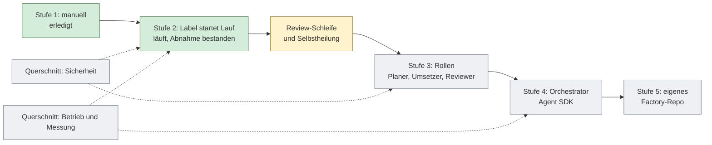

# Roadmap der Software-Factory

Stand: 24.10.2026. Diese Datei ist die langfristige Sicht auf Ausbau, Betrieb und Absicherung der Factory. Die
Stufen selbst beschreibt [process.md](process.md), die Entscheidungen stehen in den [ADRs](adr/).

**Pflege:** Wer einen Punkt umsetzt, ändert Status und Verweis im selben PR. Wird ein Punkt konkret, bekommt er ein
GitHub-Issue (Vorlage „Agent-Auftrag“ oder frei) und seine ID im Titel, zum Beispiel `[P2] Review-Schleife`. Diese
Datei hält fest, **was** und **warum** gilt, die Issues halten fest, **wer gerade woran** arbeitet.

Status: `erledigt`, `in Arbeit`, `offen`, `zu bewerten` (noch nicht entschieden, ob und wann).

## Überblick

## Stufen

| ID | Punkt | Status | Nächster Schritt / Verweis |
|---|---|---|---|
| E1 | Stufe 1: manueller Lauf mit CI-Gate | erledigt | – |
| E2 | Stufe 2: Label `agent` startet den Lauf | erledigt | Abnahme bestanden (ADR 0002, „Stand der Abnahme“). ADR-Status noch „vorgeschlagen“, auf „akzeptiert“ setzen. |
| E3 | Stufe 3: Rollen (Planer, Umsetzer, Reviewer) | zu bewerten | Erst nach der Review-Schleife. Das Vorab-Review (P4) ist ein kleiner Vorgriff. |
| E4 | Stufe 4: eigener Orchestrator mit Agent SDK | zu bewerten | Setzt E3 und Messwerte (M1) voraus. |
| E5 | Stufe 5: eigenes Repo `sw-factory` | zu bewerten | Vorher klären, was projektspezifisch und was generisch ist (W1). |

## Prozess und Review

| ID | Punkt | Status | Nächster Schritt / Verweis |
|---|---|---|---|
| P1 | Rückmeldekanal bei verbotenem Auftrag | erledigt | Kommentar im Issue (Issue #33, PR #32). |
| P2 | Review-Schleife per Kommentar `/agent …` | offen | Spike im Interaktiv-Modus der Action (`trigger_phrase`, `include_comments_by_actor`), danach ggf. Eigenbau. Schutzbereichs-Prüfung im Diff bleibt nötig. |
| P3 | Selbstheilung bei roter CI | offen | Abwandlung von `examples/ci-failure-auto-fix.yml` der Action: nur `agent/*`-PRs, Run-ID statt Logs im Prompt, Obergrenze, Freigabe. |
| P4 | Vorab-Review durch einen zweiten, schreibgeschützten Lauf | zu bewerten | Zuerst manuell `/code-review` lokal ausprobieren. Plugin-Variante: Pin- und Environment-Frage klären. |
| P5 | Rückfrage statt Raten bei mehrdeutigen Kriterien | offen | Prompt-Ergänzung: Frage ins Issue, Lauf endet. |
| P6 | Konflikte mit `main` | zu bewerten | Rebase bleibt verboten. Erlauben von `git merge origin/main` abwägen. |
| P7 | Issue-Qualität | in Arbeit | Vorlage geschärft (PR #40). Messen, ob schlechte Issues die häufigste Ursache für Nacharbeit sind (M1). |
| P8 | Lernschleife: wiederkehrende Review-Hinweise nach `CLAUDE.md` | offen | Nach dem Merge kurz festhalten, was sich wiederholt. `CLAUDE.md` ist Schutzbereich, Änderung durch den Besitzer. |

## Sicherheit

| ID | Punkt | Status | Nächster Schritt / Verweis |
|---|---|---|---|
| S1 | Technische Sperren des Agenten | erledigt | Berechtigungstest bestanden (12 von 12). Regeln in `.claude/agent-settings.json`. |
| S2 | Aktionen auf Commit-SHAs festlegen | erledigt | PR #40. Option „Require actions to be pinned“ erst nach Test einschalten. |
| S3 | Widerruf des `setup-token`-Tokens klären | offen | Besitzer: in Doku oder Einstellungen nachsehen. Ohne bekannten Widerruf ist der Verlust des Tokens ein Risiko. |
| S4 | Ablaufdaten: PAT 22.01.2027, OAuth-Token Oktober 2027 | offen | Kalendererinnerung wurde verworfen. Das Risiko ist ein plötzlich ausfallender Lauf. |
| S5 | Eigene Bot-Identität mit minimaler GitHub-App | zu bewerten | Löst: PAT als statisches Token, Agent kann technisch mergen, Approve-Review nicht möglich (Autor = Besitzer). |
| S6 | Pflicht-Check `agent-approval-check` | zu bewerten | Braucht S5. |
| S7 | Secret Scanning und Push Protection | zu bewerten | Repo-Einstellung prüfen (öffentliches Repo). Sicht darauf hat nur der Besitzer. |
| S8 | CodeQL und Egress-Filter | zu bewerten | CodeQL ist günstig, Egress-Filter aufwändiger. |
| S9 | Notausschalter | offen | Dokumentieren, wie ein laufender oder drohender Missbrauch gestoppt wird (Workflow deaktivieren, Environment-Freigabe, Tokens widerrufen, Branch-Schutz). |
| S10 | Nutzung des Abo-Tokens im Dauerbetrieb | zu bewerten | Nutzungsbedingungen und Limits für automatisierte Läufe prüfen. Ich habe das nicht geprüft. |

## Messung und Qualität

| ID | Punkt | Status | Nächster Schritt / Verweis |
|---|---|---|---|
| M1 | Kennzahlen | offen | Pro Lauf: Turns, Kosten, Dauer, Runden bis Merge, Gate beim ersten Versuch grün? Die Daten stehen im Ergebnis-JSON und in PRs. Erst ansehen, dann automatisieren. |
| M2 | Wiederholbare Referenzaufgaben (Evals) | zu bewerten | Die Test-Issues (#18 bis #35) als feste Aufgabenmenge, um Prompt- und Versionsänderungen zu vergleichen. |
| M3 | Diagnoseschritt im Agent-Workflow | in Arbeit | Bleibt bis nach P2. Dann entfernen oder bewusst behalten. |
| M4 | Prompt und `CLAUDE.md` pflegen | offen | Prompt in `agent.yml` wächst. Prüfen, was in `CLAUDE.md` gehört. |

## Betrieb

| ID | Punkt | Status | Nächster Schritt / Verweis |
|---|---|---|---|
| B1 | Updates der Action und von Claude Code | offen | Die Action installiert Claude Code zur Laufzeit (zuletzt 2.1.310). Vorgehen für Versionssprünge festlegen: neues Tag lesen, Referenzaufgaben laufen lassen, dann pinnen. |
| B2 | Kontingent bei parallelen Läufen | zu bewerten | Concurrency pro Issue erlaubt Parallelität. Beobachten, ob das Abo-Limit greift. |
| B3 | Aufräumen übrig gebliebener `agent/*`-Branches | zu bewerten | „Branch nach Merge löschen“ ist aktiv. Branches ohne PR bleiben liegen. |
| B4 | Betriebshandbuch | offen | Kurz: hängender Lauf, abgelaufenes Token, rote CI auf `main`, Verdacht auf Missbrauch (siehe S9). |
| B5 | Runner-Image und Abhängigkeiten | in Arbeit | `ubuntu-24.04` festgelegt. Dependabot läuft wöchentlich. |

## Produkt (Spielwiese)

| ID | Punkt | Status | Nächster Schritt / Verweis |
|---|---|---|---|
| X1 | Flutter-Plattformordner anlegen | offen | `flutter create --platforms=android,ios,web --project-name order_app .` in `frontend/`, danach `analysis_options.yaml` prüfen. |
| X2 | Weitere Features als reale Aufträge | offen | Nach P2, damit die Schleife an echten Änderungen getestet wird. |

## Wiederverwendung

| ID | Punkt | Status | Nächster Schritt / Verweis |
|---|---|---|---|
| W1 | Trennung generisch und projektspezifisch | zu bewerten | Workflow, Einstellungen, Vorlage, Prompt, ADR 0002 sind generisch. Spec, Gate und Stack sind es nicht. Vor Stufe 5 auflisten. |

## Blinde Flecken (ehrlich: noch nicht bewertet)

Dinge, die beim Gestalten leicht untergehen, weil der Alltag sie nicht einfordert:

1. **Messung fehlt.** Ohne Zahlen (M1) wissen wir nicht, ob die Factory Zeit spart oder nur verlagert.
2. **Regression der Factory selbst.** Ein neuer Prompt oder eine neue Action-Version kann das Verhalten verändern
   (M2, B1). Heute fällt das erst im nächsten echten Auftrag auf.
3. **Notfall.** Ein Weg, schnell zu stoppen (S9), und ein bekannter Widerruf der Tokens (S3).
4. **Ablaufende Zugänge** (S4): ein Token, das stillschweigend abläuft, stoppt den Betrieb.
5. **Nutzungsbedingungen** für den Dauerbetrieb mit dem Abo-Token (S10).
6. **Ein Einzelner als Engpass.** Review, Freigabe im Environment und Merge laufen über den Besitzer. Mehr
   Parallelität (B2) verschiebt die Last dorthin.
7. **Wissen, das im Chat bleibt.** Entscheidungen gehören in ADRs, offene Punkte in diese Datei, Lehren in `CLAUDE.md`.
