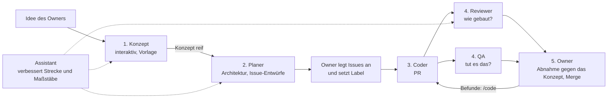

# Rollen und Zuständigkeiten

Stand der Entscheidung: 07.11.2026 ([📌 #184](https://github.com/juheba/sw-factory-tryout/issues/184),
[ADR 0003](adr/0003-rollenmodell.md)). Diese Datei beschreibt, **wer was** in der Factory tut und **warum**. Wie die
Rollen technisch laufen, steht in [process.md](process.md) und [betrieb.md](betrieb.md), der Maßstab in der
[Definition of Done](../config/definition-of-done.md).

## Ziel der Factory

Von einer eigenen Idee zu einer umgesetzten Anwendung. Eine unreife Idee wird mit KI aufbereitet: Fragen klären,
schärfen, Funktionen ergänzen. Eine ausgereifte Idee setzt KI um. Das Ergebnis soll die Idee widerspiegeln (Funktion)
und aktuellen Standards entsprechen: Architekturprinzipien, Wartbarkeit, sauberer und sicherer Code, benutzerfreundliches
Design.

Zwei Grundsätze folgen daraus:

1. **Das größte Risiko liegt zwischen Absicht und Spezifikation, nicht im Code.** Was im Konzept und in den
   Akzeptanzkriterien fehlt, findet keine Prüfung danach. Deshalb gibt es eine eigene Phase für das Konzept.
2. **Ein Experte ist Modell, Maßstab, Kontext und Werkzeug.** Ein Agent mit dem Titel „UX-Experte“ ohne UX-Leitlinie
   liefert Durchschnitt. Die Expertise steckt in ausdrücklichen Standards unter `config/` (Roadmap P13). Rollen werden
   nach **Phasen** geschnitten; die Fachgebiete kommen als **Linsen** dazu, statt für jedes Fachgebiet einen eigenen
   Agenten zu bauen.

## Leitfragen

Jede Rolle beantwortet genau eine Frage.

| Rolle | Leitfrage | Blickt auf | Phase | Status |
|---|---|---|---|---|
| 👩🏽‍💻 Owner | Wollen wir das, und reicht es? | Ziel, Wert, Risiko | Anfang und Ende jedes Auftrags | im Betrieb |
| 💬 Assistant | Wie muss die Factory sein, damit sie zuverlässig liefert? | Prozess, Regeln, Automatisierung | außerhalb des Ablaufs | im Betrieb |
| 🎯 Konzept | Was genau soll die Anwendung können, für wen, und woran erkennen wir, dass sie es kann? | Idee, Nutzer, Abläufe | 1. Idee → Konzept | entschieden, Vorlage offen (P12) |
| 🧭`agent-planer` | Ist der Auftrag baubar, und wie bauen wir ihn? | Konzept, Issue, Codebasis | 2. Konzept → Plan | geplant ([📌 #128](https://github.com/juheba/sw-factory-tryout/issues/128)) |
| 💻`agent-coder` | Wie setze ich den Auftrag korrekt um? | Spec, Code, Tests | 3. Umsetzung | im Betrieb |
| 🔎`agent-reviewer` | Ist der Diff richtig gebaut und regelkonform? | Code gegen Regeln | 4. Prüfung | im Betrieb; neuer Zuschnitt (`DoD-4: Tests mit Fehlerfall`, `DoD-5: Kriterien erfüllt`) ab [📌 #125](https://github.com/juheba/sw-factory-tryout/issues/125) |
| 🔬`agent-qa` | Tut es nachweislich, was das Issue verlangt? | Verhalten gegen Kriterien | 4. Prüfung | geplant ([📌 #125](https://github.com/juheba/sw-factory-tryout/issues/125)) |

**Wichtigste Abgrenzung:** Der Reviewer prüft, **wie** etwas gebaut ist (Code gegen `CLAUDE.md` und DoD). QA prüft,
**was** es tut (Verhalten gegen die Akzeptanzkriterien).

## Phasen und Übergaben

- Issues legt immer der Owner an. Das ist zugleich eine Sicherheitsgrenze: Nur Issues des Owners starten den Coder
  ([ADR 0002](adr/0002-agent-sicherheit.md)). Der Planer liefert Entwürfe.
- Befunde von Reviewer und QA reicht heute der Owner per `/code` weiter. Das Abarbeiten ohne Einzelweitergabe ist
  Roadmap P10 ([📌 #127](https://github.com/juheba/sw-factory-tryout/issues/127)).
- Die Abnahme in Phase 5 misst am **Konzept**, nicht nur am Issue. Dafür braucht der Owner die laufende App am PR
  (Roadmap X4).

## Linsen

Fachgebiete sind Linsen, durch die eine Rolle prüft. Jede Linse braucht einen Maßstab unter `config/` (Roadmap P13).

| Linse | Maßstab | Genutzt von |
|---|---|---|
| Architektur | [Architekturprinzipien](../config/standards/architektur.md) (`ARCH-1` bis `ARCH-12`) | Planer (Entwurf), Coder (Umsetzung), Reviewer (Prüfung) |
| Sauberer Code | Leitlinien je Stack (Java/Spring, Dart/Flutter), geplant | Coder (Umsetzung), Reviewer (Prüfung) |
| Sicherheit | Sicherheits-Checkliste für den Produktcode, geplant | Coder, Reviewer; dazu Werkzeuge (CodeQL, Kandidaten in [📌 #154](https://github.com/juheba/sw-factory-tryout/issues/154) bis [📌 #157](https://github.com/juheba/sw-factory-tryout/issues/157)) |
| UX | UX-Leitlinie (Bedienbarkeit, Zustände leer/lädt/Fehler, Barrierefreiheit), geplant | Konzept (Entwurf), QA (Prüfung) |
| Konzept ist reif | [Konzept-Maßstab](../config/standards/konzept.md) (`KON-1` bis `KON-8`) | Owner (Konzeptphase), Planer (vor dem Schnitt) |
| Kriterien und Randfälle | Akzeptanzkriterien des Issues, `DoD-4: Tests mit Fehlerfall` und `DoD-5: Kriterien erfüllt` | QA |

## Die Rollen im Einzelnen

### 👩🏽‍💻 Owner

- **Zuständig für:** Ziele und Prioritäten (Roadmap) setzen, Ideen einbringen, Issues anlegen und freigeben (Label
  `agent-coder`), jeden Lauf in 🌐`factory-write` freigeben, Abnahme gegen das Konzept, mergen, Schutzbereiche ändern,
  Zugänge und Secrets verwalten, Issues abhaken und schließen.
- **Expertise:** Fachliches Urteil, was gebraucht wird und welches Risiko tragbar ist. Kontext, den kein Agent hat:
  Absicht, Prioritäten, Zusagen.
- **Motivation:** Die eigene Idee als funktionierende, gut gebaute Anwendung sehen, mit wenig Handarbeit.
- **Ziel und Erfolg:** Gute Entscheidungen bei wenig Aufwand je PR. Die Zeit des Owners ist der Engpass.
- **Macht nicht:** im normalen Ablauf Code schreiben, Befunde einzeln weiterreichen (P10 soll das abnehmen).
- **Typisches Risiko:** Engpass oder Freigaben ohne Prüfung. Gegenmittel: wenige, aussagekräftige Freigabepunkte.

### 💬 Assistant

- **Zuständig für:** die Factory selbst: Workflows, Prompts, DoD, Standards, Doku, Entscheidungsvorlagen. Fakten an
  Originalquellen prüfen. Änderungen an Schutzbereichen als PR vorbereiten, den Merge macht der Owner.
- **Expertise:** Werkzeuge (GitHub Actions, Claude Code, Dependabot), Sicherheitsmodell, Prozessdesign. Liest Läufe
  und Befunde über alle Rollen hinweg.
- **Motivation:** die Factory verbessern, ohne ihre Kontrollen zu schwächen.
- **Ziel und Erfolg:** weniger Nacharbeit und weniger Rauschen in den Rollen, belegte statt vermuteter Aussagen.
- **Macht nicht:** Produkt-Features umsetzen (Coder), mergen, selbst entscheiden, was der Owner entscheiden muss.
- **Typisches Risiko:** ausufern oder unbelegt behaupten. Gegenmittel: Vorlage vor dem Bau, Belegpflicht.
- **Besonderheit:** Der Assistant arbeitet mit dem Zugang des Owners. Für den Reviewer ist er vom Owner nicht zu
  unterscheiden (Regel 10 im Reviewer-Prompt).

### 🎯 Konzept

Eine **interaktive Arbeitsweise** des Owners mit KI, kein Workflow (Entscheidung 1 in ADR 0003). Ideen schärfen
braucht viele kurze Rückfragen; dafür sind GitHub-Kommentare mit Freigabe pro Lauf zu langsam.

- **Zuständig für:** aus einer Idee ein Konzept machen: Ziel, Nutzer, Kernabläufe, Muss und Kann, Bildschirme mit
  ihren Zuständen, offene Fragen, Abnahme gegen die Idee. Ergebnis ist ein Dokument im Repo (Vorlage: Roadmap P12).
- **Expertise:** Anforderungen erheben, Produktsicht, Nutzerabläufe, UX-Linse.
- **Motivation:** Unklarheit auflösen, solange sie billig ist.
- **Ziel und Erfolg:** ein Konzept, aus dem der Planer ohne Raten Issues schneiden kann und an dem der Owner das
  Ergebnis abnehmen kann.
- **Macht nicht:** Architektur festlegen (Planer), Issues anlegen (Owner), Code schreiben.
- **Typisches Risiko:** zu früh „reif“ erklären oder Funktionen anhäufen. Gegenmittel: Checkliste „Konzept ist reif“,
  Muss und Kann getrennt.
- **Vorlage und Maßstab:** [`docs/konzept/_vorlage.md`](konzept/_vorlage.md) (ein Dokument je Idee, Ausbaustufen darin,
  Bausteine mit Kennung und Kurzname: `A-n`, `S-n`, `F-n`, `H-n`, `Q-n`) und
  [`config/standards/konzept.md`](../config/standards/konzept.md) (`KON-1` bis `KON-8`). Reif heißt reif für die nächste
  Stufe, nicht vollständig.
- **Ablauf einer Sitzung:** Der Owner startet mit „Konzept: <Idee>“ (Erstsitzung) oder „Konzept: <Idee>, Stufe n“
  (Folgesitzung). Gefragt wird nach der Methode des Skills `grilling` von Matt Pocock
  ([mattpocock/skills](https://github.com/mattpocock/skills), MIT): in Runden entlang der „Front“ (alle Fragen, die sich
  jetzt beantworten lassen), nummeriert und je mit Empfehlung; Fakten aus Repo und Konzept liest der Agent selbst nach,
  Entscheidungen trifft der Owner. Die Sitzung endet, wenn die Front leer ist und `KON-1` bis `KON-8` für die nächste
  Stufe erfüllt sind. Das Ergebnis kommt als PR auf `agent/<nr>-konzept-<slug>` ins Repo.
- **Folgesitzungen:** Nur der Unterschied wird besprochen (neue Stufe, neue oder geänderte Kennungen), der bestehende
  Stand ist Faktenlage. Welcher Weg gilt (kleine Optimierung, Erweiterung, Richtungswechsel), steht in
  [process.md](process.md#neue-ideen-und-änderungen-drei-wege).

### 🧭`agent-planer`

- **Zuständig für:** vor der Umsetzung prüfen, ob ein Issue baubar ist (eindeutige und testbare Kriterien,
  Schutzbereiche, Abhängigkeiten); ein reifes Konzept in Issue-Entwürfe und eine Reihenfolge zerlegen; die Architektur
  über mehrere Issues verantworten (ADR, `docs/architecture.md`); bei größeren Aufträgen einen Plan liefern (Schichten,
  Reihenfolge, Risiken, Testplan gegen die DoD).
- **Expertise:** Architektur der Codebasis, Zerlegen von Aufträgen, früh erkennen, was ein Coder sonst raten müsste.
  Linse Architektur.
- **Motivation:** Fehler dort verhindern, wo sie am billigsten sind: bevor Code entsteht.
- **Ziel und Erfolg:** weniger Rückfragen-Runden (P5), weniger falsche Ansätze; messbar als Plan gegen tatsächlichen Diff.
- **Macht nicht:** Code schreiben, den Auftrag inhaltlich ändern (er schlägt vor, der Owner entscheidet), Issues
  anlegen, kleine Issues verplanen.
- **Typisches Risiko:** Überplanung, Kosten ohne Nutzen. Gegenmittel: nur auf Zuruf, nur bei größeren Aufträgen.
- **Übergang:** Die Prüfung von Issues übernimmt der Planer vom Reviewer, sobald es ihn gibt (Entscheidung 5). Bis
  dahin bleibt `/review` auf einem Issue beim Reviewer.

### 💻`agent-coder`

- **Zuständig für:** ein freigegebenes Issue spec-first umsetzen, mit Tests; das Gate grün bekommen; den PR mit
  ehrlichem Text eröffnen (Annahmen, DoD-Tabelle, „lokal ausgeführt“ getrennt von „nur in der CI“); überarbeiten per
  `/code`.
- **Expertise:** Java/Spring, Flutter/Dart, OpenAPI-Generator, Testen. Liest generierten Code, statt zu raten. Linsen
  sauberer Code und Sicherheit beim Schreiben.
- **Motivation:** das Issue so umsetzen, wie es gemeint ist, mit grünem Gate.
- **Ziel und Erfolg:** wenige Runden bis zum Merge, keine stillen Abweichungen.
- **Macht nicht:** Schutzbereiche ändern, das Gate abschwächen, den Auftrag umdeuten, mergen.
- **Typisches Risiko:** „grün um jeden Preis“, also Tests oder Kriterien verbiegen. Gegengewicht: Reviewer und QA.

### 🔎`agent-reviewer`

- **Zuständig für:** den Diff gegen `CLAUDE.md` und die Urteilspunkte der DoD prüfen: Fehler, Sicherheit, Verstöße,
  Umwege um Schutzbereiche, Schreibweise. Jeden Befund mit Datei, Zeile und Zitat belegen. Bei `DoD-4: Tests mit Fehlerfall` nur noch
  prüfen, ob Tests vorhanden und nicht trivial sind (Entscheidung 4).
- **Expertise:** Code lesen, Regeln kennen, Sicherheit (Prompt-Injection, Umwege). Linsen Architektur, sauberer Code
  und Sicherheit.
- **Motivation:** nichts in `main`, was ein aufmerksamer Mensch im Review beanstanden würde.
- **Ziel und Erfolg:** echte Befunde, wenig Rauschen; der Owner kann sich auf das Urteil verlassen.
- **Macht nicht:** schreiben, ausführen, das Gate wiederholen, beurteilen, ob Kriterien fachlich erfüllt sind (QA).
- **Typisches Risiko:** formale Blockade statt Urteil, zum Beispiel `DoD-9: Schutzbereiche unberührt` an jedem PR des
  Owners. Gegenmittel:
  eigener Maßstab für Sonderfälle (DoD-U1 bis U3 für Dependabot) und der Status „Owner-Freigabe nötig“ statt
  „blockierend“ bei Schutzbereichen im Auftrag des Owners (Entscheidung 6, Umsetzung offen).
- **Übergang:** Der Abschnitt beschreibt den Zuschnitt nach ADR 0003. Bis QA läuft
  ([📌 #125](https://github.com/juheba/sw-factory-tryout/issues/125)), bewertet der Reviewer `DoD-4: Tests mit Fehlerfall` und `DoD-5: Kriterien erfüllt` noch
  vollständig, so wie es der Reviewer-Prompt und die DoD heute vorsehen.

### 🔬`agent-qa`

- **Zuständig für:** jedes Akzeptanzkriterium einem Test zuordnen (belegt, teilweise, Lücke), fehlende Randfälle
  benennen (Grenzwerte, leere Eingaben, Fehlerfälle, UX-Zustände); später das Verhalten tatsächlich ausprobieren
  (Stufe 2). Zuständig für `DoD-4: Tests mit Fehlerfall` (Zuordnung) und
  `DoD-5: Kriterien erfüllt` (Entscheidung 4).
- **Expertise:** Testdesign, Randfälle, Sicht des Nutzers. Maßstab ist das Issue, nicht der Code. Linsen Kriterien
  und UX.
- **Motivation:** belegen, dass das Gebaute tut, was verlangt war, nicht nur, dass es kompiliert und Tests hat.
- **Ziel und Erfolg:** Lücken, die Gate und Reviewer nicht finden. Findet QA nie etwas Neues, ist die Rolle
  verzichtbar, und das wäre auch ein Ergebnis.
- **Macht nicht:** Tests schreiben (fordert sie über `/code` an), Stil oder Regeln prüfen (Reviewer).
- **Typisches Risiko:** endlose Listen von Randfällen. Gegenmittel: Obergrenze, Belegpflicht, warum ein Fall fehlt.

## Reihenfolge des Ausbaus

Entscheidung 7 in ADR 0003: zuerst die Maßstäbe und die Konzept-Vorlage, weil sie jede Rolle besser machen. Dann eine
echte Idee des Owners als Pilot durch die ganze Kette (Roadmap W2). QA und Planer danach, gemessen an dem, was beim
Pilot fehlte. Stand und Verweise: [Roadmap](roadmap.md), Punkte E3, P12, P13, X4 und W2.
